# TypeScript Loop Programming Practice

This project contains beginner-friendly TypeScript programs for practicing `for`, `while`, `do...while`, and combined loop logic. Each question includes a screenshot using the image's existing path inside the `screenshots` folder.

## For Loop Programs

### 1. Write a program to print numbers from 1 to 50.

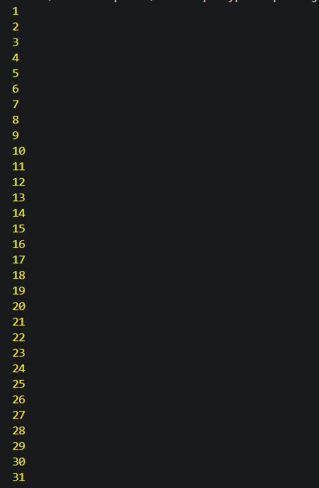

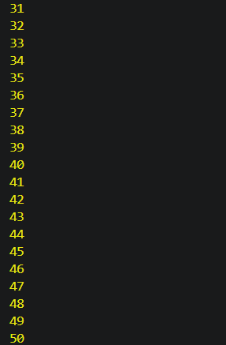

### 2. Write a program to print the squares of numbers from 1 to 10.

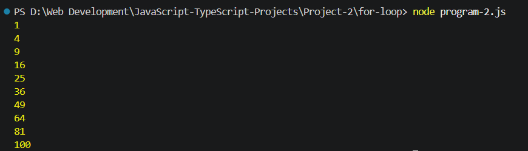

### 3. Write a program to print the cubes of numbers from 1 to 10.

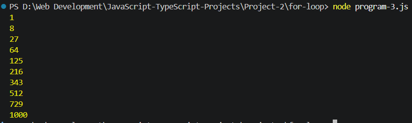

### 4. Write a program to calculate the factorial of 5.

### 5. Write a program to print the Fibonacci series for 15 terms.

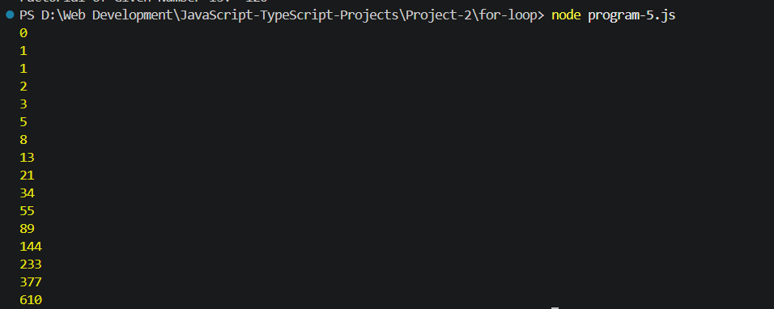

---

## While Loop Programs

### 6. Write a program to print numbers from 1 to 10.

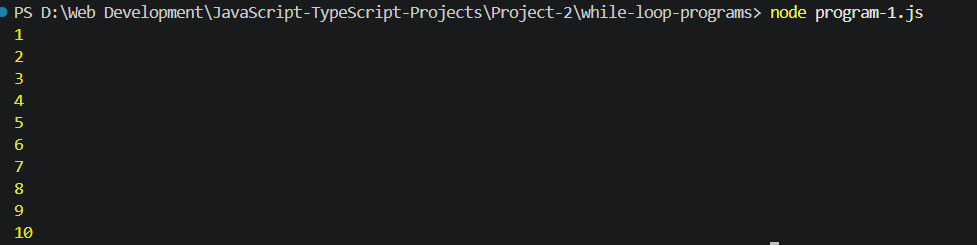

### 7. Write a program to print numbers from 10 to 1 in descending order.

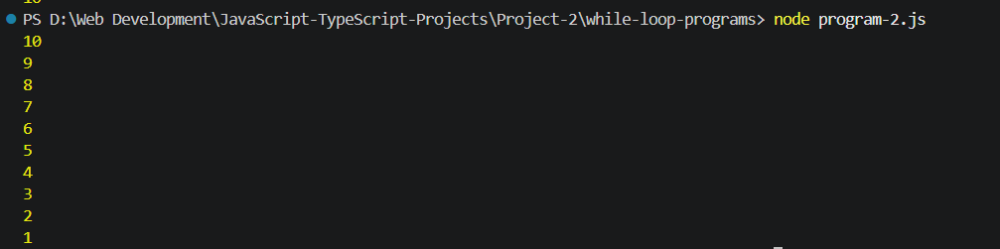

### 8. Write a program to calculate the sum of the first N natural numbers.

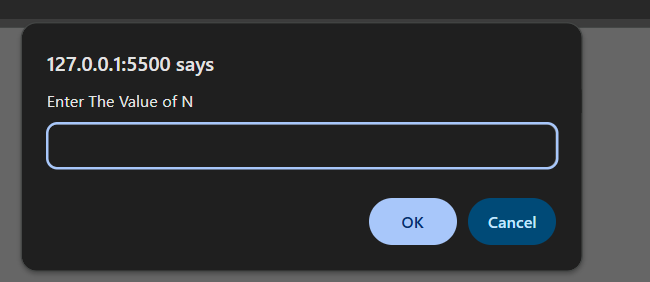

### 9. Write a program to print the multiplication table of 15.

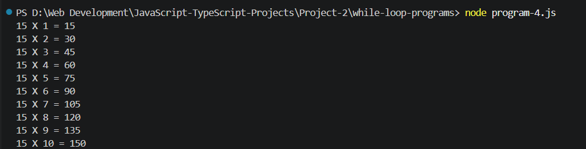

### 10. Write a program to count the digits in a number.

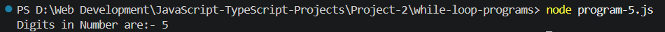

---

## Do-While Loop Programs

### 11. Write a program to print numbers from 1 to 20.

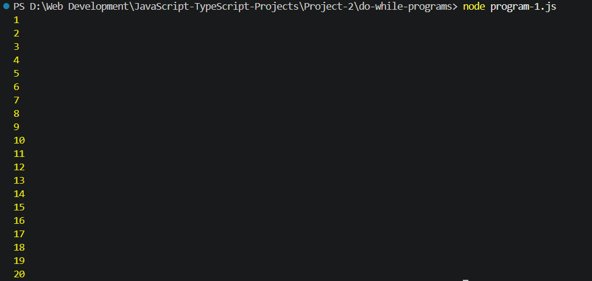

### 12. Write a program to print all even numbers from 1 to 100.

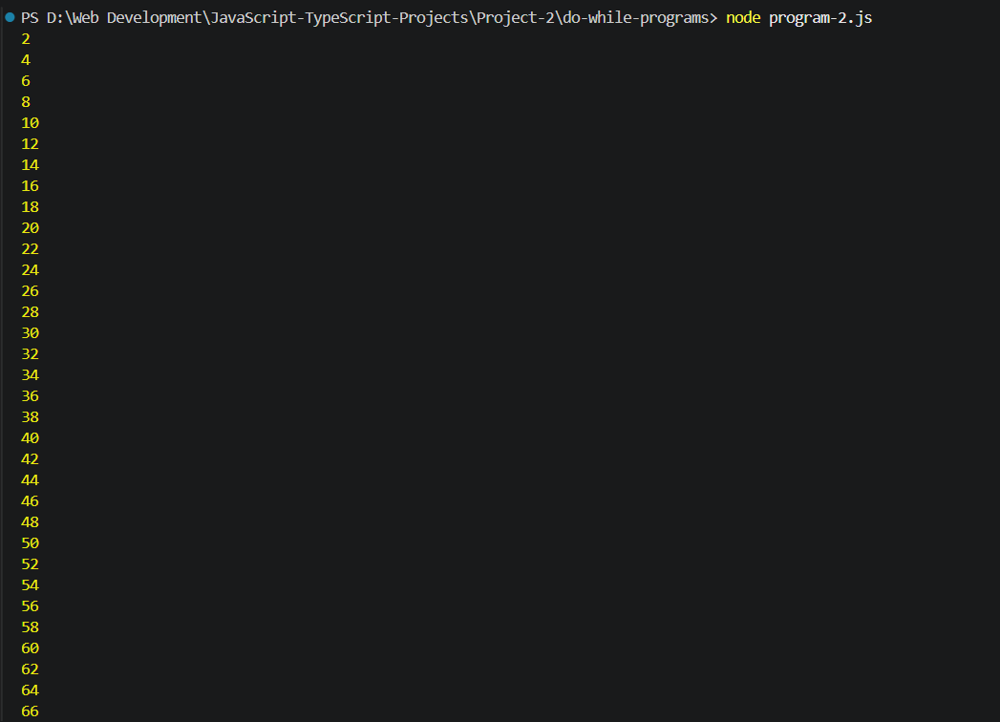

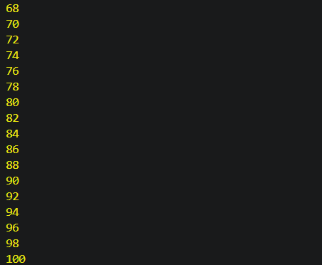

### 13. Write a program to print all odd numbers from 1 to 100.

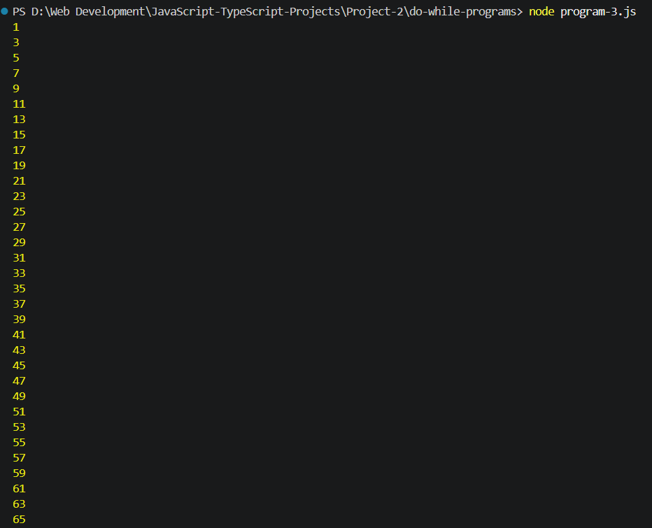

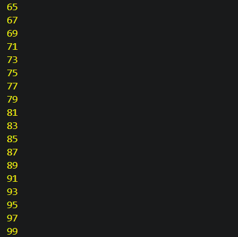

### 14. Write a program to reverse a number.

### 15. Write a program to calculate the sum of the digits of a number.

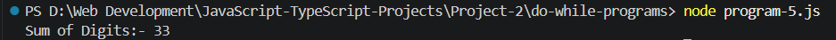

---

## Mixed Loop Programs

### 16. Write a program to check whether a number is prime.

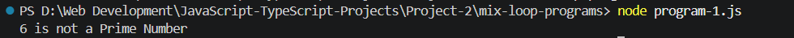

### 17. Write a program to check whether a number is a palindrome.

### 18. Write a program to check whether a number is an Armstrong number.

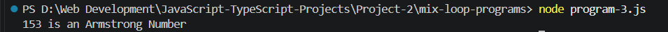

### 19. Write a program to print a star pyramid pattern using nested loops.

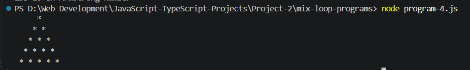

### 20. Write a number-guessing program that keeps asking until the correct number is entered and then displays the number of attempts.

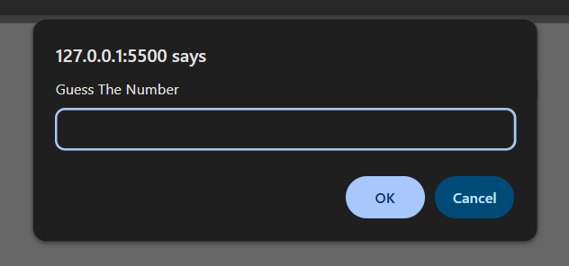

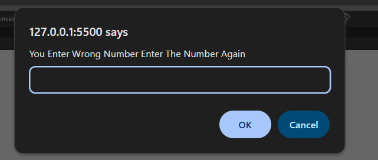

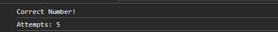

---

## Explanation Video

Add your project explanation video link below:

[▶️ Project Explanation Video](https://drive.google.com/drive/folders/10f5NQDUtAkOWy5Y-dh4KDC9vWfMqh77J?usp=sharing)

